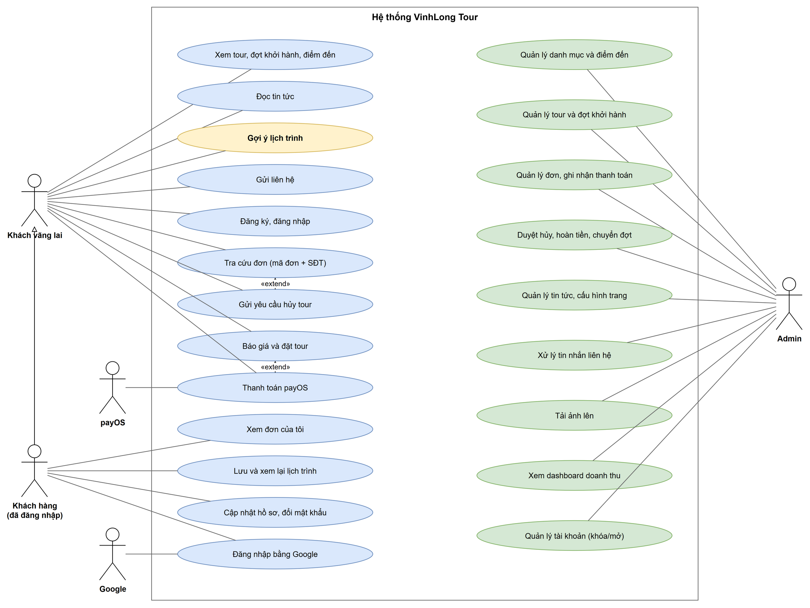
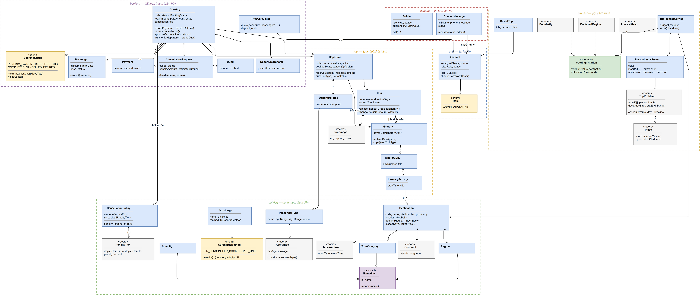
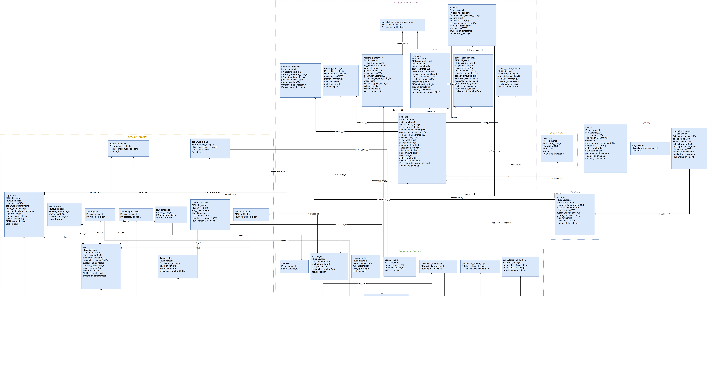
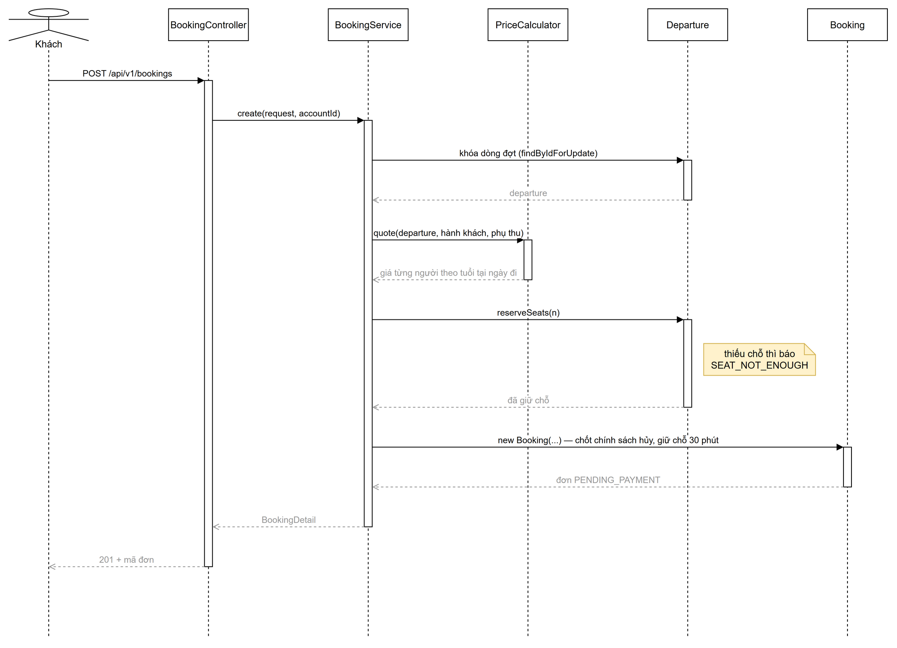
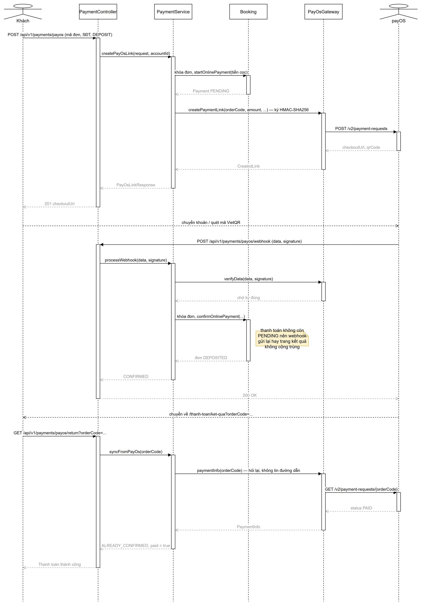
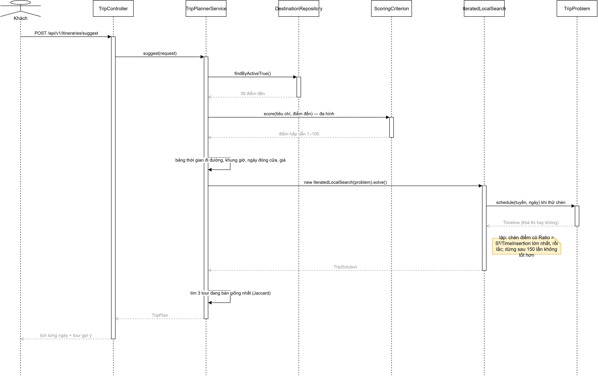
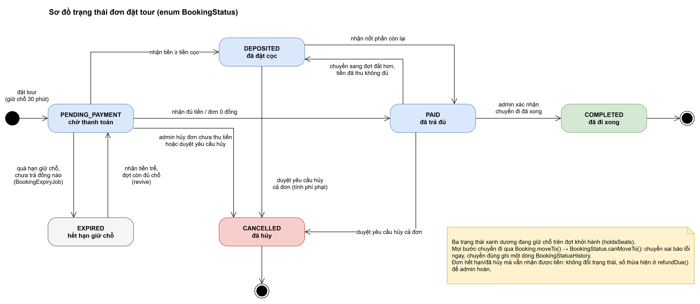
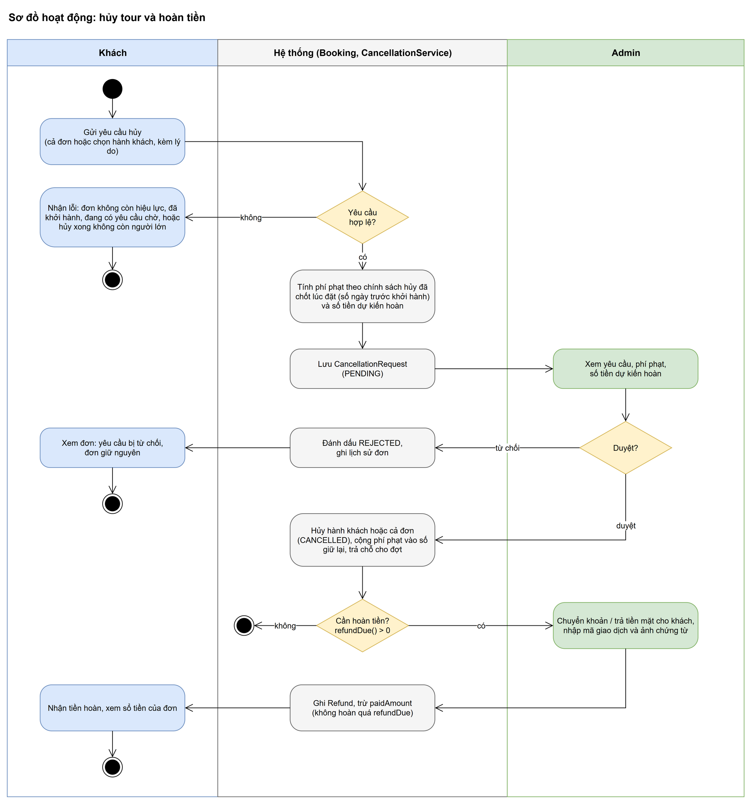
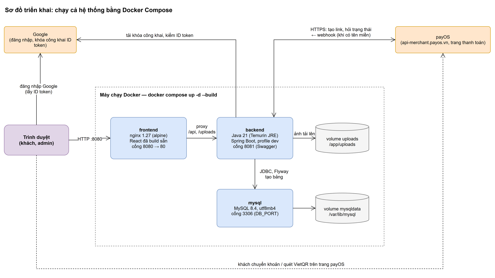

# XÂY DỰNG WEBSITE GIỚI THIỆU DU LỊCH KẾT HỢP ĐẶC TOUR TẠI ĐỊA BÀN TỈNH VĨNH LONG


Đồ án môn **Lập trình ứng dụng hướng đối tượng**: website giới thiệu du lịch, đặt tour và gợi ý lịch trình cho khách du lịch tỉnh Vĩnh Long mới (khu vực Vĩnh Long, Bến Tre, Trà Vinh cũ).

> Backend viết lại theo 10 giai đoạn (xem [`docs/KE_HOACH_BACKEND.md`](docs/KE_HOACH_BACKEND.md)); frontend gọi API mới `/api/v1` (đối chiếu API cũ → mới ở [`docs/API_CHANGES.md`](docs/API_CHANGES.md)) và có trang **Gợi ý lịch trình** (`/goi-y-lich-trinh`). Thanh toán trực tuyến qua **payOS** (chuyển khoản ngân hàng, quét mã VietQR).

| Thành phần | Công nghệ |
|---|---|
| Backend | Java 21, Spring Boot 4.1 (Web MVC, Data JPA, Validation, Security + JWT, Actuator), Flyway, springdoc-openapi (Swagger) |
| CSDL | MySQL 8.4 chạy bằng Docker — **không dùng XAMPP** (XAMPP cài MariaDB, không phải MySQL) |
| Frontend | React 19 + Vite, React Router, Axios |
| Thanh toán | payOS (API v2): tạo link thanh toán, webhook có chữ ký HMAC-SHA256 |
| Đóng gói | Docker Compose: MySQL + backend + frontend (nginx) |
| Kiểm thử | JUnit 5, Testcontainers (MySQL thật trong Docker), Postman |

## Chạy toàn bộ bằng Docker (chỉ cần Docker Desktop)

```bash
docker compose up -d --build
```

Lần đầu mất vài phút để build. Sau đó mở http://localhost:8080 (trang web), Swagger ở http://localhost:8081/swagger-ui.html. Ba container: `mysql`, `backend` (profile `dev`, có dữ liệu demo và tài khoản ở bảng dưới), `frontend` (nginx phục vụ trang và chuyển `/api`, `/uploads` sang backend). Ảnh tải lên nằm trong volume `uploads`, không mất khi khởi động lại. Sửa code xong thì chạy lại lệnh trên để build lại.

Trang web gọi API qua chính địa chỉ `http://localhost:8080`; mở bằng địa chỉ khác (IP máy, tên miền) thì phải build lại frontend với `VITE_API_URL` tương ứng (`frontend/Dockerfile`).

Muốn bấm thanh toán thật, tạo file `.env` cạnh `docker-compose.yml` (đã có trong `.gitignore`, không đưa lên git) rồi chạy lại lệnh trên:

```bash
PAYOS_CLIENT_ID=...
PAYOS_API_KEY=...
PAYOS_CHECKSUM_KEY=...
```

Cách lấy khóa xem mục [Thanh toán payOS](#thanh-toán-payos). Không có khóa thì mọi chức năng khác vẫn chạy, riêng nút thanh toán báo `PAYOS_NOT_CONFIGURED`; admin vẫn xác nhận chuyển khoản/tiền mặt bằng tay được.

## Chạy để phát triển (máy mới clone về)

Cần cài sẵn **JDK 21** (ví dụ `winget install EclipseAdoptium.Temurin.21.JDK`, kiểm tra `java -version` ra `21`; máy còn JDK cũ thì đặt `JAVA_HOME` trỏ tới JDK 21) và **Docker Desktop** (đang mở). Không cần cài Maven.

```bash
docker compose up -d mysql
cd backend
./mvnw spring-boot:run -Dspring-boot.run.profiles=dev
```

Windows CMD/PowerShell dùng `mvnw.cmd spring-boot:run "-Dspring-boot.run.profiles=dev"` cho lệnh cuối.

Khoảng 30 giây sau backend chạy ở http://localhost:8081. Bảng trong CSDL do **Flyway** tự tạo, không cần import file SQL. Profile `dev` tự nạp **dữ liệu demo** khi CSDL chưa có tour nào:

| | |
|---|---|
| Admin | `admin@vinhlongtour.vn` / `Admin@12345` |
| Khách mẫu | `khach@demo.vn` / `Demo@12345` (có sẵn một đơn đã thanh toán) |
| Dữ liệu | 38 điểm đến thật, 4 tour đang bán với 12 đợt khởi hành trong tháng tới, chính sách hủy, điểm đón, phụ thu, 3 đơn ở 3 trạng thái, bài viết, cấu hình trang, một tin nhắn liên hệ |

| Địa chỉ | Nội dung |
|---|---|
| http://localhost:8081/swagger-ui.html | Tài liệu và thử mọi API. Gọi `POST /api/v1/auth/login`, chép `token`, bấm **Authorize** và dán vào để thử API cần đăng nhập |
| http://localhost:8081/actuator/health | Tình trạng backend (`UP`) |

Frontend: `cd frontend && cp .env.example .env && npm install && npm run dev` → http://localhost:5173.

Dừng CSDL: `docker compose down` (giữ dữ liệu) hoặc `docker compose down -v` (xóa sạch, lần chạy sau nạp lại demo). Nếu cổng 3306 đã bị chiếm (thường do XAMPP hoặc MySQL cài sẵn trên máy đang chạy): tắt chương trình đó, hoặc chạy `DB_PORT=3307 docker compose up -d mysql` và đặt `DB_URL=jdbc:mysql://localhost:3307/vinhlongtour`.

Xem dữ liệu bằng công cụ quen thuộc (MySQL Workbench, DBeaver, HeidiSQL...): host `localhost`, cổng `3306`, CSDL `vinhlongtour`, tài khoản `vinhlong` / `vinhlong`.

## Chạy không có dữ liệu demo (giống môi trường thật)

Bỏ `-Dspring-boot.run.profiles=dev` và tự đặt biến môi trường. Profile `dev` có mật khẩu, khóa viết sẵn trong `application-dev.yml` nên **không bao giờ bật khi chạy thật**.

```bash
ADMIN_PASSWORD=MatKhauAdminCuaBan JWT_SECRET=chuoi-ngau-nhien-it-nhat-32-ky-tu ./mvnw spring-boot:run
# Windows PowerShell: $env:ADMIN_PASSWORD="..."; $env:JWT_SECRET="..."; .\mvnw.cmd spring-boot:run
```

| Biến | Mặc định | Ý nghĩa |
|---|---|---|
| `ADMIN_EMAIL`, `ADMIN_PASSWORD` | `admin@vinhlongtour.vn`, *trống* | Tài khoản admin đầu tiên. Chỉ tạo khi CSDL chưa có admin; để trống mật khẩu thì không tạo |
| `JWT_SECRET` | *trống* | Khóa ký token đăng nhập, ít nhất 32 ký tự. Để trống: sinh khóa ngẫu nhiên mỗi lần chạy, phải đăng nhập lại sau khi khởi động lại backend |
| `GOOGLE_CLIENT_ID` | *trống* | Client ID (loại Web application) trên Google Cloud Console, giống `VITE_GOOGLE_CLIENT_ID` của frontend. Để trống thì đăng nhập Google báo `GOOGLE_NOT_CONFIGURED` |
| `CORS_ORIGINS` | `http://localhost:5173` | Địa chỉ frontend được gọi API, nhiều địa chỉ cách nhau bằng dấu phẩy |
| `PAYOS_CLIENT_ID`, `PAYOS_API_KEY`, `PAYOS_CHECKSUM_KEY` | *trống* | Ba khóa của kênh thanh toán payOS (xem [Thanh toán payOS](#thanh-toán-payos)). Để trống thì tạo link thanh toán báo `PAYOS_NOT_CONFIGURED`; profile `dev` cũng không có sẵn khóa |
| `PAYOS_RETURN_URL`, `PAYOS_CANCEL_URL` | `http://localhost:5173/thanh-toan/ket-qua` | Trang frontend payOS đưa khách về sau khi trả tiền / bấm hủy. Chạy bằng Docker thì `docker-compose.yml` đã đặt về cổng 8080 |
| `PAYOS_API_URL` | `https://api-merchant.payos.vn` | Địa chỉ API payOS (test tự dựng payOS giả và đổi biến này) |
| `UPLOAD_DIR` | `uploads` (trong thư mục `backend`) | Nơi lưu ảnh admin tải lên, phục vụ ở `http://localhost:8081/uploads/<tên file>`. Chỉ nhận JPEG, PNG, GIF, WebP, tối đa 5 MB |
| `SERVER_PORT`, `DB_URL`, `DB_USER`, `DB_PASSWORD` | khớp `docker-compose.yml` | Cổng backend và kết nối CSDL |

## Thanh toán payOS

1. Đăng ký tài khoản miễn phí ở https://my.payos.vn, liên kết một tài khoản ngân hàng, tạo **kênh thanh toán** và chép **Client ID**, **Api Key**, **Checksum Key** vào ba biến `PAYOS_*` ở trên.
2. Khách bấm thanh toán ở trang đơn → backend tạo link (`POST /api/v1/payments/payos`) → khách chuyển khoản hoặc quét mã VietQR trên trang payOS. Link hết hạn sau 15 phút; mỗi đơn chỉ có một link đang chờ.
3. Backend ghi nhận tiền theo hai đường, đường nào đến trước cũng chỉ cộng tiền một lần:
   - **Trang kết quả**: payOS đưa khách về `/thanh-toan/ket-qua?orderCode=...`, frontend gọi `GET /api/v1/payments/payos/return`; backend **hỏi lại payOS** trạng thái thật (không tin tham số trên đường dẫn). Đường này đủ khi chạy trên máy cá nhân.
   - **Webhook**: khi có tên miền thật, khai báo `https://<tên miền>/api/v1/payments/payos/webhook` ở mục webhook của kênh thanh toán. Dữ liệu sai chữ ký hoặc sai số tiền bị bỏ qua.
4. Chuyển khoản/tiền mặt ngoài payOS: admin xác nhận ở trang chi tiết đơn (`POST /api/v1/admin/bookings/{id}/payments`).

## Kiểm thử

```bash
cd backend
./mvnw verify
```

Cần Docker Desktop đang chạy: test tích hợp tự bật một MySQL tạm trong Docker và xóa đi sau khi xong. Có test riêng cho từng giai đoạn, gồm: hai người tranh chỗ cuối chỉ một người được, webhook payOS gửi hai lần chỉ ghi một lần, trang kết quả không ghi nhận khi payOS chưa báo đã trả (dùng một payOS giả chạy trong test), chữ ký payOS khớp một bản tính độc lập trong test, ví dụ tính tay của thuật toán gợi ý lịch trình ra đúng từng số, dashboard đếm đúng.

### Kiểm thử API bằng Postman

Bộ request có kiểm tra tự động nằm ở `backend/postman/VinhLong Tour API/` (định dạng thư mục YAML của Postman 12, mỗi giai đoạn một thư mục). Biến `adminPassword` có sẵn giá trị khớp profile `dev`. Giai đoạn 5 kiểm phần payOS khi backend chưa có khóa payOS.

1. Trong Postman 12, mở thư mục `backend/postman/VinhLong Tour API` vào workspace của bạn (file liên kết workspace là của riêng từng máy nên không đưa lên git).
2. Bật backend (profile `dev`), bấm chuột phải vào collection → **Run** để chạy toàn bộ theo thứ tự.

Chạy bằng dòng lệnh (Postman CLI, không cần đăng nhập Postman), từ thư mục gốc dự án:

```bash
npx -p postman-cli postman collection run "backend/postman/VinhLong Tour API"
```

Chạy backend với mật khẩu admin khác thì thêm `--env-var "adminPassword=..."`.

## Tài liệu

| Tài liệu | Nội dung |
|---|---|
| [`docs/KE_HOACH_BACKEND.md`](docs/KE_HOACH_BACKEND.md) | Kế hoạch, kiến trúc, OOP áp dụng ở đâu, thuật toán gợi ý lịch trình (TOPTW + Iterated Local Search) và bảng so sánh với cách tham lam |
| [`docs/OOP.md`](docs/OOP.md) | Đóng gói, kế thừa, đa hình, trừu tượng, mẫu thiết kế: nằm ở lớp nào, file nào (dùng cho báo cáo) |
| [`docs/API_CHANGES.md`](docs/API_CHANGES.md) | Đối chiếu API cũ → mới theo từng trang frontend |
| [`docs/diagrams/`](docs/diagrams/) | 9 sơ đồ UML, ERD và triển khai, xem mục [Sơ đồ](#sơ-đồ) bên dưới |
| [`docs/data/`](docs/data/) | 38 điểm đến thật (CSV), nguồn và độ tin cậy từng dòng |

## Sơ đồ

Mọi sơ đồ nằm trong [`docs/diagrams/`](docs/diagrams/). File `.drawio.png` có nhúng sẵn sơ đồ: mở chính file ảnh (hoặc file `.drawio` cùng tên) bằng draw.io để sửa, rồi xuất lại PNG.

| Sơ đồ | Nội dung |
|---|---|
| [Use case](docs/diagrams/use-case.drawio.png) | Chức năng của khách vãng lai, khách hàng, admin; tác nhân ngoài payOS, Google |
| [Lớp](docs/diagrams/class-diagram.drawio.png) | Các lớp chính theo gói nghiệp vụ, kế thừa `NamedItem`/`MoneyTransaction`, interface `ScoringCriterion` |
| [ERD](docs/diagrams/erd.drawio.png) | 37 bảng MySQL, sinh từ các file migration |
| [Tuần tự: đặt tour](docs/diagrams/sequence-booking.drawio.png) | Khóa dòng đợt, tính giá theo tuổi, giữ chỗ 30 phút |
| [Tuần tự: thanh toán payOS](docs/diagrams/sequence-payment.drawio.png) | Tạo link, webhook có chữ ký, trang kết quả hỏi lại payOS, không cộng tiền trùng |
| [Tuần tự: gợi ý lịch trình](docs/diagrams/sequence-planner.drawio.png) | Chấm điểm đa hình (`ScoringCriterion`), thuật toán Iterated Local Search |
| [Trạng thái đơn](docs/diagrams/state-booking.drawio.png) | 6 trạng thái của `BookingStatus`, 11 bước chuyển hợp lệ và sự kiện gây ra từng bước |
| [Hoạt động: hủy tour và hoàn tiền](docs/diagrams/activity-cancellation.drawio.png) | Khách gửi yêu cầu, hệ thống tính phí phạt, admin duyệt/từ chối, hoàn tiền |
| [Triển khai](docs/diagrams/deployment.drawio.png) | Docker Compose: nginx, backend, MySQL, volume; kết nối payOS, Google |

### Use case


### Lớp


### ERD


### Tuần tự: đặt tour


### Tuần tự: thanh toán payOS


### Tuần tự: gợi ý lịch trình


### Trạng thái đơn


### Hoạt động: hủy tour và hoàn tiền


### Triển khai


## Cấu trúc thư mục

```
vinhlong-travel/
├── docker-compose.yml        # MySQL + backend + frontend (chỉ bật mysql khi tự chạy backend)
├── backend/
│   ├── src/main/java/vn/edu/tvu/vinhlongtour/
│   │   ├── auth/             # tài khoản, đăng nhập, JWT, Google
│   │   ├── catalog/          # khu vực, loại hình, dịch vụ, loại khách, điểm đón, phụ thu, chính sách hủy, điểm đến
│   │   ├── tour/             # tour, lịch trình, đợt khởi hành
│   │   ├── booking/          # đặt tour, giữ chỗ, tính giá
│   │   ├── payment/          # payOS (tạo link, trang kết quả, webhook), ghi nhận thanh toán thủ công
│   │   ├── cancellation/     # hủy tour, hoàn tiền, chuyển đợt
│   │   ├── planner/          # gợi ý lịch trình (thuật toán ILS) và lịch trình đã lưu
│   │   ├── content/          # tin tức, cấu hình trang, liên hệ
│   │   ├── upload/           # upload ảnh
│   │   ├── dashboard/        # số liệu trang quản trị
│   │   ├── demo/             # dữ liệu demo (chỉ profile dev)
│   │   └── common/           # lỗi chung, phân trang, cấu hình
│   ├── src/main/resources/db/migration/   # Flyway: V1__... tới V10__...
│   └── postman/              # bộ kiểm thử Postman + file mẫu để thử upload
├── frontend/                 # React + Vite, gọi API /api/v1; Dockerfile + nginx.conf để chạy bằng Docker
└── docs/                     # kế hoạch, đối chiếu API, sơ đồ, dữ liệu điểm đến
```
